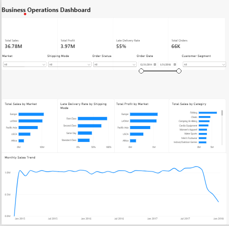

# Business Operations Analytics Dashboard

A PostgreSQL and Microsoft Power BI project using the DataCo SMART Supply Chain dataset.

The project analyzes 180,519 supply-chain records to examine sales, profitability, product performance, markets, shipping methods, and late deliveries.

## Dashboard



## Key Metrics

- Total Sales: $36.78M
- Total Profit: $3.97M
- Late Deliveries: 98,977
- Orders: 65,752
- Customers: 20,652
- Products: 118

## Reproduce the Analysis

### 1. Download the dataset

Download **DataCo SMART Supply Chain for Big Data Analysis** from the original [Mendeley Data record](https://data.mendeley.com/datasets/8gx2fvg2k6/1).

Place `DataCoSupplyChainDataset.csv` at:

`data/raw/DataCoSupplyChainDataset.csv`

The dataset is not committed because of its size and because its source schema contains customer contact and password fields that are unnecessary for this analysis.

### 2. Create an analytics-safe file

Run:

```bash
python scripts/prepare_safe_dataset.py
```

This creates `data/processed/dataco_analytics_safe.csv` containing only the fields required by the dashboard. Customer email, password, street address, first name, last name, latitude, and longitude are excluded.

### 3. Create and load PostgreSQL tables

From the repository root, run:

```bash
psql -d business_operations -f sql/01_load.sql
psql -d business_operations -f sql/02_transform.sql
psql -d business_operations -f sql/03_analysis.sql
```

`01_load.sql` recreates the raw analytics table and loads the processed CSV. `02_transform.sql` creates a typed view for Power BI. `03_analysis.sql` reproduces and validates the main dashboard metrics.

## Dashboard Analysis

- Total Sales and Profit by Market
- Total Sales by Category
- Late Delivery Rate by Shipping Mode
- Monthly Sales Trend

Interactive filters support Market, Shipping Mode, Order Status, Order Date, and Customer Segment.

## Key Findings

Europe generated the highest total sales at approximately $10.87M and the highest total profit at approximately $1.17M.

LATAM was the second-largest market, generating approximately $10.28M in sales and $1.12M in profit.

Fishing was the highest-revenue product category at approximately $6.93M, followed by Cleats at $4.43M and Camping & Hiking at $4.12M.

Delivery performance varied substantially by shipping mode:

- First Class: 95.32% late-delivery rate
- Second Class: 76.63%
- Same Day: 45.74%
- Standard Class: 38.07%

Monthly sales remained relatively stable through much of 2015–2017 before declining sharply near the end of the dataset.

## Recommendations

- Review the First Class carrier contract and fulfillment process first.
- Shift eligible orders toward better-performing shipping options while service levels are investigated.
- Investigate the late-period sales decline before using the trend for forecasting.

## Data Validation

Dashboard results were independently validated against PostgreSQL queries for total sales, total profit, late deliveries, sales and profit by market, sales by category, late-delivery rate by shipping mode, and monthly sales.

## Technology

- PostgreSQL
- Microsoft Power BI
- SQL
- Python standard library
- Git and GitHub

## Privacy Design

The original source includes fields that are not needed for portfolio analytics. The published workflow deliberately excludes direct customer contact details, passwords, street addresses, and precise coordinates before database loading.

Contact: [LinkedIn](https://www.linkedin.com/in/roustam-mamedov-analytics/)
